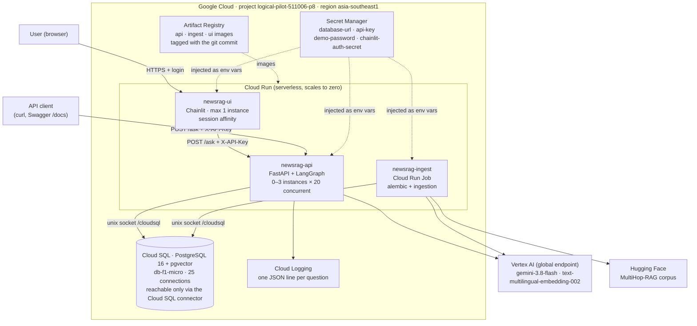
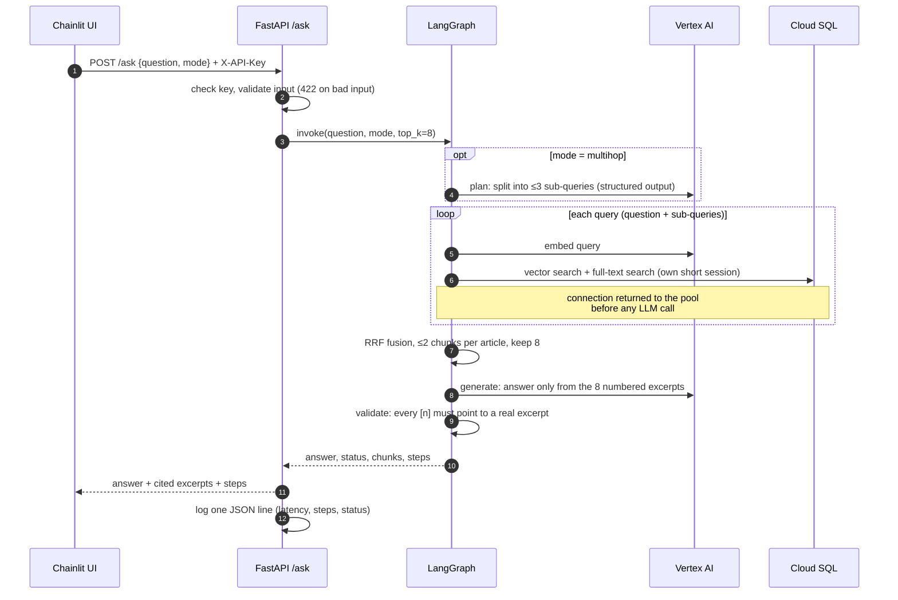
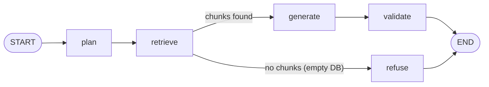
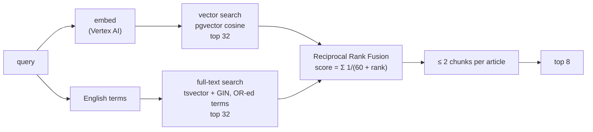
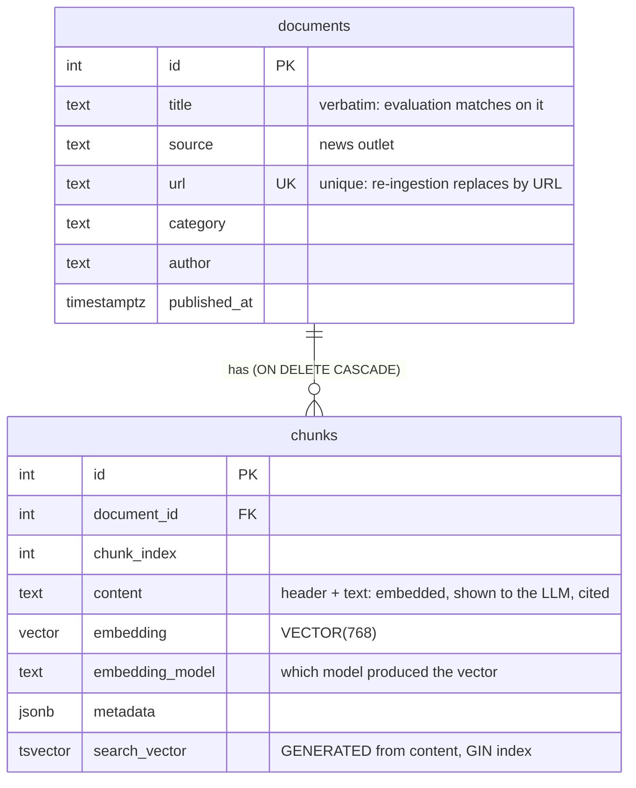

# Architecture

> **Stateless compute, a stateful database, a simple service boundary, and measured
> AI quality.**

The RAG application is stateless, so Cloud Run can scale it horizontally. PostgreSQL
holds all state, so it is one managed Cloud SQL instance that every instance
shares, and connection limits are sized for that. The whole RAG pipeline lives in
one service: splitting retrieval, embedding and generation into microservices would
add network hops, auth and deployments with no scaling benefit at this size. A piece
can be pulled out later if it becomes its own bottleneck.

## 1. Deployment on Google Cloud



| Component | Purpose | Key settings |
|---|---|---|
| **Cloud Run `newsrag-api`** | The RAG API | 1 vCPU, 1 GiB; 0–3 instances; concurrency 20; request timeout 120 s; service account `newsrag-run` |
| **Cloud Run `newsrag-ui`** | Chainlit chat UI. Calls the API over HTTPS. | 512 MiB; at most 1 instance with session affinity (Chainlit holds a WebSocket per chat); timeout 3600 s; demo login; service account `newsrag-ui` |
| **Cloud Run Job `newsrag-ingest`** | One-off batch: migrations, then ingestion | 2 GiB, 1-hour task timeout, 1 retry; same service account as the API |
| **Cloud SQL** | Documents, chunks, embeddings, full-text index | PostgreSQL 16, Enterprise edition, `db-f1-micro`, zonal, 10 GB SSD |
| **Secret Manager** | All secrets; nothing in code, images or git | 4 secrets, each readable only by the service accounts that need it |
| **Artifact Registry** | Container images | 3 images built from 2 Dockerfiles, tagged with the git commit |
| **Vertex AI** | Embeddings and Gemini | Authenticated by the service account (IAM). **There is no LLM API key to leak.** |

### Identity and access (least privilege)

| Service account | Used by | Roles |
|---|---|---|
| `newsrag-run` | API and ingest job | `aiplatform.user`, `cloudsql.client`; `secretAccessor` on `database-url` and `api-key` only |
| `newsrag-ui` | Chainlit UI | `secretAccessor` on `api-key`, `demo-password` and `chainlit-auth-secret` only. No database or Vertex AI access. |

### Network

Cloud SQL has no authorised networks: nothing on the internet can connect to it
directly. Cloud Run reaches it through the **Cloud SQL connector**, a unix socket at
`/cloudsql/<connection-name>` that is authenticated with IAM and encrypted with TLS. So
`DATABASE_URL` points at a socket, not an IP address:

```text
postgresql+asyncpg://rag:<password>@/rag?host=/cloudsql/<project>:asia-southeast1:newsrag-db
```

Production would go further: private IP only, a VPC connector for Cloud Run's outbound
traffic, and Cloud Armor in front of the services (see [section 8](#8-demo-vs-production)).

## 2. Request flow



## 3. The RAG graph



| Node | LLM call | Role |
|---|---|---|
| `plan` | 1 (multihop only) | Splits the question into ≤3 English sub-queries, one per outlet, person or event. The original question is always searched too. If planning fails, the node falls back to the original question instead of failing the request. |
| `retrieve` | – | Hybrid search for each query, then RRF across queries, at most 2 chunks per article, 8 excerpts. |
| `generate` | 1 | Answers **only** from the numbered excerpts. Line 1 is the short answer; then an explanation with `[n]` citations, in the question's language. Says `Insufficient information.` when the excerpts do not contain the answer. |
| `validate` | – | Deterministic check: there must be at least one citation, and every `[n]` must exist. Otherwise the answer becomes a refusal. This checks citation *integrity*, not *faithfulness*, which is measured offline. |
| `refuse` | – | Safety guard for an empty database. |

LLM calls per question are bounded: **1 for baseline, 2 for multihop**. The graph has
no loops. Each node appends to `steps`, so every response carries its own execution
trace.

The graph receives its retriever, LLM and planner from outside (dependency
injection). The same graph code runs in the API, in evaluation (real dependencies) and
in tests (stubs: no database, no network).

## 4. Retrieval design



| Decision | Why |
|---|---|
| **Chunks of ~1,000 characters, 150 overlap, cut at sentence ends** | One vector per topic, not per 12,500-character article. The overlap keeps facts that straddle a boundary whole in at least one chunk. |
| **`Source \| Date \| Title` header on every chunk** | Questions name outlets and dates ("according to TechCrunch..."), but article bodies rarely name their own outlet. Without the header, those words match nothing. |
| **Hybrid: vector + keyword** | Embeddings match meaning ("automaker acquired" ↔ "car company bought"). Keywords match exact names ("TechCrunch", "Bankman-Fried"). |
| **RRF instead of a weighted sum** | Cosine similarity and `ts_rank` are on unrelated scales. RRF uses only ranks: no weights to tune. |
| **Fetch 4× candidates, keep 8** | A chunk ranked 12th by vector search and 2nd by keyword search must still reach the fusion step. |
| **≤ 2 chunks per article** | Found through error analysis: one article filled 7 of 8 slots on a three-article question. With the cap, all evidence articles are found in **41% → 60%** of questions (main sample) and **35% → 49%** (held-out sample), with zero regressions. |
| **Full-text `'english'` config, `websearch_to_tsquery` with OR** | Stemming ("running" → "run"). The parser is safe on arbitrary input. OR means a long question still matches. |
| **Thai questions** | PostgreSQL has no Thai text-search config. The multilingual embedding handles meaning across languages; English names inside a Thai question still go through keyword search. |
| **No vector index (exact scan)** | A few thousand chunks scan in milliseconds, with exact results. HNSW becomes worthwhile at around 10⁵–10⁶ chunks. |

## 5. Data model



- `search_vector` is a **generated column**, so it can never drift out of sync with `content`.
- `embedding_model` is stored on every chunk. Re-ingesting with a different model
  replaces the old vectors instead of mixing them.
- Schema changes go through Alembic. The first migration is hand-written: autogenerate
  never emits `CREATE EXTENSION vector`.

## 6. Code structure and patterns

```text
routers/   HTTP only: auth, validation, response mapping, logging
graph/     orchestration: nodes, prompts, wiring. Never imports the database.
services/  repository (all SQL) · retriever · embeddings/llm factories · chunker
models/    SQLAlchemy tables · Pydantic schemas
core/      settings
```

| Pattern | Where | Concrete benefit |
|---|---|---|
| **Repository** | `services/repository.py` | Every SQL statement is in one file. Callers never build queries, and storage could change without touching the graph. |
| **Factory** | `services/embeddings.py`, `services/llm.py` | `EMBEDDING_PROVIDER=fake` runs the full test suite with no GCP account; `vertex` switches to real models. One line in `.env`. |
| **Dependency injection** | `graph/workflow.py`, `services/rag.py` | One graph, three uses: API, evaluation (the exact production pipeline), and tests with stubs. |
| **Protocol (structural typing)** | `EmbeddingProvider`, `Retriever`, `Planner` | Fakes and stubs fit without inheritance. |

## 7. Production readiness

### Availability

| | Demo setup | How it holds up |
|---|---|---|
| Compute | Cloud Run, regional | Managed, restarts failed instances, spreads across zones |
| Database | Cloud SQL, zonal | **Single point of failure in the demo.** Production: regional HA (standby in a second zone). |
| Health checks | `/health` (liveness) and `/ready` (database reachable) | Liveness never touches the database, so a database outage doesn't trigger restart loops of healthy containers. |
| Failure handling | Gemini calls have a 40 s timeout and no hidden retries. Planning failures fall back to the plain question. LLM or database errors become a clear `503`. | A slow or rate-limited model can't hang a request past Cloud Run's 120 s limit. |
| Shutdown | The lifespan hook disposes the connection pool on SIGTERM | Connections are released immediately when Cloud Run stops an instance. |

### Scalability: compute scales, the database is shared

```text
newsrag-api instance 1 ── pool 5 ──┐
newsrag-api instance 2 ── pool 5 ──┼──► Cloud SQL (max_connections = 25)
newsrag-api instance 3 ── pool 5 ──┘
            max 3 × 5 = 15 connections; 10 spare for the ingest job and admin
```

- **Connections are sized explicitly.** SQLAlchemy's default pool (5 + 10 overflow)
  multiplied by Cloud Run's default 100 instances would exceed the 25 connections of
  the smallest Cloud SQL tier many times over.
- **Connections are not held during LLM calls.** A request spends ~50 ms in the
  database and 10–20 s waiting for Gemini. The retriever opens its own short session
  per search and closes it before the LLM is called. One pooled connection therefore
  serves many concurrent requests, and the bottleneck moves to Vertex AI quota, where
  it belongs.

| If this becomes the bottleneck | Fix |
|---|---|
| Database connections | Smaller pool or `--max-instances`; at larger scale, PgBouncer |
| Vector search latency | HNSW index on `embedding` |
| Database CPU | Larger tier, read replicas (retrieval is read-only) |
| Repeated questions | Cache answers by (question, mode), e.g. in Memorystore |
| Vertex AI rate limits (429) | Client-side retry with back-off, a quota increase, a concurrency cap |
| Per-question latency (14–20 s p50) | Lower thinking level, streaming responses to the UI |

### Cost

| Item | Behaviour | Approximate cost (demo) |
|---|---|---|
| Cloud Run (API, UI, Job) | Billed only while handling requests (`min-instances=0`) | Mostly within the free tier |
| Cloud SQL `db-f1-micro` | **Billed while running, even when idle** | ~$8–10 / month; stop it with `--activation-policy=NEVER` |
| Vertex AI | Per token / per character | Expected to be a few dollars for one ingestion plus a 100-question evaluation; check the billing report for actuals |
| Artifact Registry, Secret Manager | Storage and access | Cents |

Cost controls: `--max-instances` caps spend; `/ask` requires an API key, and the UI
requires a login, so a public URL cannot spend LLM quota; thinking level `low`; a budget
alert on the billing account. Figures are estimates; check current GCP pricing.

### Security

- **No secrets in code, images or git.** Locally they live in `.env` (git-ignored and
  excluded from images by `.dockerignore`). In production they come from Secret
  Manager, injected at runtime.
- **No LLM API key exists:** Vertex AI is authorised through the service account.
- **Least-privilege service accounts**, granted only the specific secrets they need.
- **Containers run as a non-root user.** The API image contains only runtime
  dependencies.
- **API key compared in constant time** (`secrets.compare_digest`). The UI has a
  login, because it holds the API key.
- **Question text is not logged**, since user input may contain personal data. Only
  its length is logged.

### Observability

Each `/ask` writes one JSON line to stdout: request ID, mode, status, execution steps,
number of excerpts and citations, model, latency. Cloud Logging turns it into a
structured entry that can be filtered and charted by field, for example latency by
mode or the rate of `validate:fail`.

## 8. Demo vs production

| | This deployment | Production |
|---|---|---|
| Cloud SQL | Zonal, `db-f1-micro`, no backups | Regional HA, larger tier, automated backups + point-in-time recovery |
| Network | Public IP, no authorised networks, connector only | Private IP, VPC connector, Cloud Armor + HTTPS load balancer |
| Auth | Shared API key; a demo login on the UI | Identity-Aware Proxy or OAuth per user; keys per client, rotated |
| Vector search | Exact scan | HNSW index |
| CI/CD | Manual `docker build` / `gcloud run deploy` | GitHub Actions with Workload Identity Federation (no JSON keys), deploying on merge |
| Observability | Structured logs | Plus uptime checks, alerting on error rate and latency, tracing |
| Data residency | Gemini via the `global` endpoint (newest models are served there first) | A regional endpoint if data must stay in one region |

## 9. Key decisions and trade-offs

| Decision | Alternative considered | Reason |
|---|---|---|
| **pgvector inside PostgreSQL** | Qdrant or another vector database | The test requires PostgreSQL, and at this scale one database gives vectors, full-text search and ACID with nothing extra to operate. Revisit at millions of chunks. |
| **One API service** | Separate retrieval, embedding and generation services | No component has a different scaling profile yet. Splitting adds latency, auth and deployments without benefit. |
| **UI as a separate service** | Serving the UI from the API | Different runtime (WebSockets, session affinity) and dependencies. The API stays usable through `/docs` if the UI fails. |
| **LangGraph for orchestration, LangChain only as the model interface** | LangChain vector stores and retrievers | The graph makes control flow and the trace explicit. LangChain vector stores impose their own schema, which conflicts with Alembic and the generated full-text column. |
| **Query decomposition (`plan`)** | Iterative, multi-round retrieval | Parallel sub-queries fit cross-outlet comparison questions with bounded cost (2 LLM calls). Iterative retrieval, where hop 2 depends on hop 1's answer, is the next step for true bridge questions. |
| **Deterministic `validate`** | An LLM groundedness judge | Free, instant and reproducible. It checks citation integrity; faithfulness is measured offline in the evaluation. |
| **Multilingual embedding model** | English-only embeddings | Thai questions retrieve English news. |
| **Gemini thinking level `low`, 40 s timeout, no retries** | Model defaults | The defaults took ~40 s per answer and could hang for minutes on retries. Failing fast keeps requests within Cloud Run's timeout; the client decides whether to retry. |
| **Per-article cap = 2** | No cap, or other values | Measured on two independent samples. Other values were not tuned on the test set, to avoid overfitting. |

## 10. Deployment steps

The commands used for this deployment, in order (bash syntax):

```bash
PROJECT=logical-pilot-511006-p8; REGION=asia-southeast1
REGISTRY=$REGION-docker.pkg.dev/$PROJECT/newsrag; TAG=$(git rev-parse --short HEAD)

# 1. APIs and image registry
gcloud services enable artifactregistry.googleapis.com run.googleapis.com \
  sqladmin.googleapis.com secretmanager.googleapis.com iam.googleapis.com aiplatform.googleapis.com
gcloud artifacts repositories create newsrag --repository-format=docker --location=$REGION
gcloud auth configure-docker $REGION-docker.pkg.dev

# 2. Images: api and ingest from one multi-stage Dockerfile, ui from frontend/Dockerfile
docker build --target api    -t $REGISTRY/api:$TAG .    && docker push $REGISTRY/api:$TAG
docker build --target ingest -t $REGISTRY/ingest:$TAG . && docker push $REGISTRY/ingest:$TAG
docker build -f frontend/Dockerfile -t $REGISTRY/ui:$TAG . && docker push $REGISTRY/ui:$TAG

# 3. Database
gcloud sql instances create newsrag-db --database-version=POSTGRES_16 --edition=enterprise \
  --tier=db-f1-micro --region=$REGION --storage-size=10 --availability-type=zonal --no-backup
gcloud sql databases create rag --instance=newsrag-db
gcloud sql users create rag --instance=newsrag-db --password=<generated>
CONN=$(gcloud sql instances describe newsrag-db --format='value(connectionName)')

# 4. Secrets (values written from files, never typed into commands)
gcloud secrets create database-url --data-file=<file>   # postgresql+asyncpg://rag:…@/rag?host=/cloudsql/$CONN
gcloud secrets create api-key --data-file=<file>

# 5. Service account with least privilege
gcloud iam service-accounts create newsrag-run
SA=newsrag-run@$PROJECT.iam.gserviceaccount.com
gcloud projects add-iam-policy-binding $PROJECT --member=serviceAccount:$SA --role=roles/aiplatform.user
gcloud projects add-iam-policy-binding $PROJECT --member=serviceAccount:$SA --role=roles/cloudsql.client
gcloud secrets add-iam-policy-binding database-url --member=serviceAccount:$SA --role=roles/secretmanager.secretAccessor
gcloud secrets add-iam-policy-binding api-key      --member=serviceAccount:$SA --role=roles/secretmanager.secretAccessor

# 6. Migrate + ingest (Cloud Run Job)
gcloud run jobs create newsrag-ingest --image=$REGISTRY/ingest:$TAG --region=$REGION \
  --service-account=$SA --set-cloudsql-instances=$CONN --set-secrets=DATABASE_URL=database-url:latest \
  --set-env-vars=EMBEDDING_PROVIDER=vertex,GCP_PROJECT=$PROJECT,GCP_LOCATION=global \
  --memory=2Gi --task-timeout=3600 --max-retries=1
gcloud run jobs execute newsrag-ingest --region=$REGION --wait

# 7. API
gcloud run deploy newsrag-api --image=$REGISTRY/api:$TAG --region=$REGION --service-account=$SA \
  --add-cloudsql-instances=$CONN \
  --set-secrets=DATABASE_URL=database-url:latest,API_KEY=api-key:latest \
  --set-env-vars=EMBEDDING_PROVIDER=vertex,LLM_PROVIDER=vertex,LLM_MODEL=gemini-3.8-flash,LLM_THINKING_LEVEL=low,GCP_PROJECT=$PROJECT,GCP_LOCATION=global,DEFAULT_MODE=multihop \
  --allow-unauthenticated --min-instances=0 --max-instances=3 --concurrency=20 --timeout=120 --memory=1Gi

# 8. UI (its own service account: secrets only)
gcloud run deploy newsrag-ui --image=$REGISTRY/ui:$TAG --region=$REGION --service-account=newsrag-ui@$PROJECT.iam.gserviceaccount.com \
  --set-env-vars=API_URL=<API_URL> \
  --set-secrets=API_KEY=api-key:latest,DEMO_PASSWORD=demo-password:latest,CHAINLIT_AUTH_SECRET=chainlit-auth-secret:latest \
  --allow-unauthenticated --session-affinity --min-instances=0 --max-instances=1 --timeout=3600 --memory=512Mi
```
