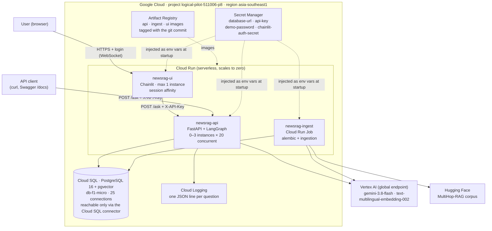
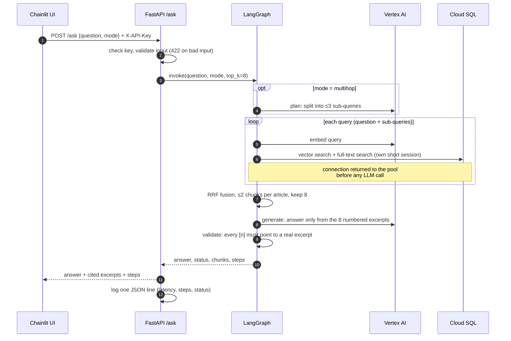
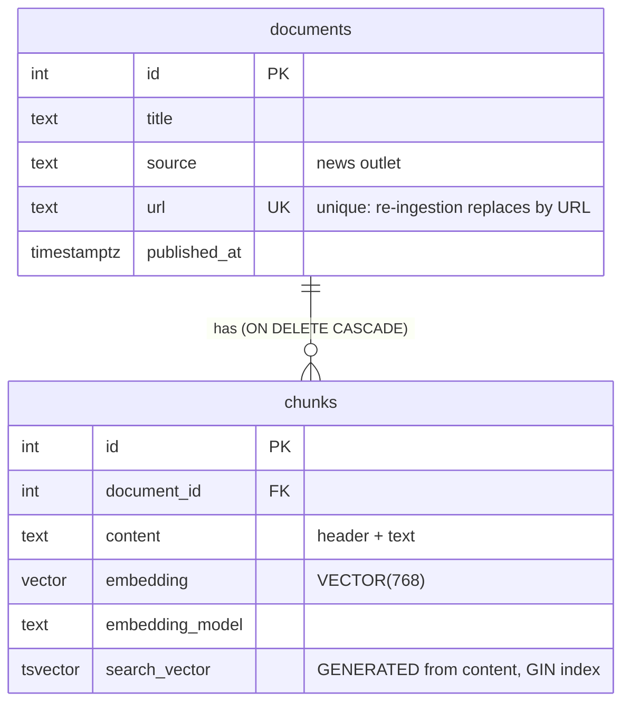

# Architecture

> **Stateless compute, one stateful database, and a simple service boundary.**

The RAG application is stateless, so Cloud Run can scale it horizontally. All state
lives in one managed Cloud SQL instance shared by every instance, and connection
limits are sized for that. The whole RAG pipeline is one service: splitting it into
microservices would add network hops, auth and deployments with no scaling benefit at
this size.

## 1. Deployment on Google Cloud



| Component | Purpose | Key settings |
|---|---|---|
| **Cloud Run `newsrag-api`** | The RAG API | 1 vCPU, 1 GiB; 0–3 instances; concurrency 20; timeout 120 s |
| **Cloud Run `newsrag-ui`** | Chainlit chat UI; calls the API over HTTPS | 512 MiB; 1 instance with session affinity (WebSocket per chat); demo login |
| **Cloud Run Job `newsrag-ingest`** | One-off batch: migrations, then ingestion | 2 GiB, 1-hour timeout, 1 retry |
| **Cloud SQL** | Documents, chunks, embeddings, full-text index | PostgreSQL 16, `db-f1-micro`, zonal, 10 GB SSD |
| **Secret Manager** | All secrets; nothing in code, images or git | 4 secrets, each readable only by the accounts that need it |
| **Artifact Registry** | Container images | 3 images, tagged with the git commit |
| **Vertex AI** | Embeddings and Gemini | Authorised by the service account (IAM): **no LLM API key exists** |

| Service account | Used by | Roles (least privilege) |
|---|---|---|
| `newsrag-run` | API and ingest job | `aiplatform.user`, `cloudsql.client`; `secretAccessor` on `database-url` and `api-key` only |
| `newsrag-ui` | Chainlit UI | `secretAccessor` on `api-key`, `demo-password`, `chainlit-auth-secret` only. No database or Vertex AI access. |

## 2. Request flow



LLM calls per question are bounded: **1 for baseline, 2 for multihop**, with no loops.
`validate` is deterministic (no LLM call): an answer that cites nothing, or cites an
excerpt that does not exist, becomes a refusal.

**Retrieval** combines two searches, because news questions mix described events with
exact names:
- **Vector search** (pgvector cosine) matches meaning.
- **Keyword search** (PostgreSQL full text with a GIN index) matches exact names such as "TechCrunch".
- **Reciprocal Rank Fusion** merges the two lists by rank, so there are no weights to tune.
- **At most 2 chunks per article** keeps one long article from filling every slot.
- **`Source | Date | Title` header on every chunk** lets questions that name outlets and dates match.

## 3. Data model



Vectors, full text and metadata live in one PostgreSQL database. `search_vector` is a
generated column, so it can never drift out of sync with `content`. Schema changes go
through Alembic.

## 4. Deployment steps

The commands used for this deployment, in order (bash syntax):

```bash
PROJECT=logical-pilot-511006-p8; REGION=asia-southeast1
REGISTRY=$REGION-docker.pkg.dev/$PROJECT/newsrag; TAG=$(git rev-parse --short HEAD)

# 1. APIs and image registry
gcloud services enable artifactregistry.googleapis.com run.googleapis.com \
  sqladmin.googleapis.com secretmanager.googleapis.com iam.googleapis.com aiplatform.googleapis.com
gcloud artifacts repositories create newsrag --repository-format=docker --location=$REGION
gcloud auth configure-docker $REGION-docker.pkg.dev

# 2. Images: api and ingest from one multi-stage Dockerfile, ui from frontend/Dockerfile
docker build --target api    -t $REGISTRY/api:$TAG .    && docker push $REGISTRY/api:$TAG
docker build --target ingest -t $REGISTRY/ingest:$TAG . && docker push $REGISTRY/ingest:$TAG
docker build -f frontend/Dockerfile -t $REGISTRY/ui:$TAG . && docker push $REGISTRY/ui:$TAG

# 3. Database
gcloud sql instances create newsrag-db --database-version=POSTGRES_16 --edition=enterprise \
  --tier=db-f1-micro --region=$REGION --storage-size=10 --availability-type=zonal --no-backup
gcloud sql databases create rag --instance=newsrag-db
gcloud sql users create rag --instance=newsrag-db --password=<generated>
CONN=$(gcloud sql instances describe newsrag-db --format='value(connectionName)')

# 4. Secrets (values written from files, never typed into commands)
gcloud secrets create database-url --data-file=<file>   # postgresql+asyncpg://rag:…@/rag?host=/cloudsql/$CONN
gcloud secrets create api-key --data-file=<file>
gcloud secrets create demo-password --data-file=<file>
gcloud secrets create chainlit-auth-secret --data-file=<file>   # from `chainlit create-secret`

# 5. Service accounts with least privilege (API + job; the UI gets its own in step 8)
gcloud iam service-accounts create newsrag-run
SA=newsrag-run@$PROJECT.iam.gserviceaccount.com
gcloud projects add-iam-policy-binding $PROJECT --member=serviceAccount:$SA --role=roles/aiplatform.user
gcloud projects add-iam-policy-binding $PROJECT --member=serviceAccount:$SA --role=roles/cloudsql.client
gcloud secrets add-iam-policy-binding database-url --member=serviceAccount:$SA --role=roles/secretmanager.secretAccessor
gcloud secrets add-iam-policy-binding api-key      --member=serviceAccount:$SA --role=roles/secretmanager.secretAccessor

# 6. Migrate + ingest (Cloud Run Job)
gcloud run jobs create newsrag-ingest --image=$REGISTRY/ingest:$TAG --region=$REGION \
  --service-account=$SA --set-cloudsql-instances=$CONN --set-secrets=DATABASE_URL=database-url:latest \
  --set-env-vars=EMBEDDING_PROVIDER=vertex,GCP_PROJECT=$PROJECT,GCP_LOCATION=global \
  --memory=2Gi --task-timeout=3600 --max-retries=1
gcloud run jobs execute newsrag-ingest --region=$REGION --wait

# 7. API
gcloud run deploy newsrag-api --image=$REGISTRY/api:$TAG --region=$REGION --service-account=$SA \
  --add-cloudsql-instances=$CONN \
  --set-secrets=DATABASE_URL=database-url:latest,API_KEY=api-key:latest \
  --set-env-vars=EMBEDDING_PROVIDER=vertex,LLM_PROVIDER=vertex,LLM_MODEL=gemini-3.8-flash,LLM_THINKING_LEVEL=low,GCP_PROJECT=$PROJECT,GCP_LOCATION=global,DEFAULT_MODE=multihop \
  --allow-unauthenticated --min-instances=0 --max-instances=3 --concurrency=20 --timeout=120 --memory=1Gi

# 8. UI (its own service account: three secrets, no database or Vertex AI access)
gcloud iam service-accounts create newsrag-ui
UI_SA=newsrag-ui@$PROJECT.iam.gserviceaccount.com
for SECRET in api-key demo-password chainlit-auth-secret; do
  gcloud secrets add-iam-policy-binding $SECRET --member=serviceAccount:$UI_SA --role=roles/secretmanager.secretAccessor
done
gcloud run deploy newsrag-ui --image=$REGISTRY/ui:$TAG --region=$REGION --service-account=$UI_SA \
  --set-env-vars=API_URL=<API_URL> \
  --set-secrets=API_KEY=api-key:latest,DEMO_PASSWORD=demo-password:latest,CHAINLIT_AUTH_SECRET=chainlit-auth-secret:latest \
  --allow-unauthenticated --session-affinity --min-instances=0 --max-instances=1 --timeout=3600 --memory=512Mi
```
