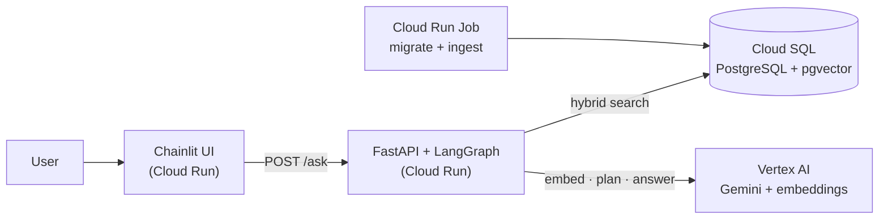

# NewsRAG — multi-hop question answering over the news

Ask a question that needs evidence from **several news articles** and get a short
answer with **citations to the exact excerpts** it is based on. If the articles do
not contain the answer, the system says so instead of guessing.

Built with FastAPI, PostgreSQL + pgvector, LangGraph and Gemini on Vertex AI, and
deployed on Google Cloud Run with Cloud SQL.

| | |
|---|---|
| **Chat UI (live)** | https://newsrag-ui-cgblbum2pa-as.a.run.app — login details are sent separately |
| **API docs (live)** | https://newsrag-api-cgblbum2pa-as.a.run.app/docs — `POST /ask` needs the `X-API-Key` header, sent separately |
| **Architecture** | [ARCHITECTURE.md](ARCHITECTURE.md) |
| **Evaluation** | [EVALUATION.md](EVALUATION.md) |

```text
Q: Who is the individual associated with the cryptocurrency industry facing a criminal
   trial on fraud and conspiracy charges, as reported by both The Verge and TechCrunch?

A: Sam Bankman-Fried
   Both The Verge and TechCrunch report that Sam Bankman-Fried, the founder of FTX,
   is facing a criminal trial on charges including wire fraud and conspiracy [1][4] ...

   [1] The Verge   · 2023-09-28 · The FTX trial is bigger than Sam Bankman-Fried
   [4] TechCrunch  · 2023-10-01 · SBF's trial starts soon, but how did he — and FTX — get here?
```

## Try the live demo

**Chat UI**
1. Open the [chat UI](https://newsrag-ui-cgblbum2pa-as.a.run.app) and sign in with username `demo` and the password sent to you separately.
2. Click one of the four starter questions, or type your own in English or Thai.
3. While it runs, a step shows the trace (`plan → retrieve → generate → validate`) and the time taken. An answer takes about 15–20 s. The first question after a quiet period can take a few seconds longer, while Cloud Run starts an instance.
4. Click a **Source N** link to open the exact excerpt behind the answer.
5. Use the ⚙️ settings to switch between `multihop` (default) and `baseline`, and compare them.

**API:** open the [API docs](https://newsrag-api-cgblbum2pa-as.a.run.app/docs), choose `POST /ask` → **Try it out**, and put the API key
sent to you in the `x-api-key` field.

## Highlights

- **Hybrid retrieval.** pgvector similarity search and PostgreSQL full-text search,
  merged with Reciprocal Rank Fusion. News questions mix described events with named
  outlets and people: embeddings catch the first, keywords the second.
- **A per-article cap found through error analysis.** One long article was filling
  7 of 8 excerpt slots on a question that needed three. Capping each article at 2
  chunks raised "all evidence found" from 41% to 60% (14 questions improved, none got
  worse). A held-out sample confirmed it: 35% → 49%, 11 improved, none worse.
- **Multi-hop query planning with LangGraph.** In `multihop` mode, Gemini splits the
  question into one search per outlet or event (`plan → retrieve → generate →
  validate`). Every step is recorded in the response.
- **Grounded answers.** Answers must cite excerpts. A deterministic `validate` step
  rejects answers with missing or invented citations. On unanswerable questions the
  system refused 25 of 25 times; the LLM alone invented an answer 7 times.
- **Measured, not assumed.** Retrieval and answer quality were evaluated on 100
  stratified questions with 95% confidence intervals and paired comparisons. The
  results are reported as measured, including the negative ones.
- **Production-minded deployment.** Stateless Cloud Run services, Cloud SQL, Secret
  Manager, least-privilege service accounts, a connection pool sized against Cloud
  SQL's connection limit, and bounded LLM timeouts.

## Results at a glance

Full report with setup and interpretation: [EVALUATION.md](EVALUATION.md).

**Retrieval** (75 answerable questions, top 10 chunks):

| | vector | keyword | **hybrid + cap (deployed)** |
|---|---|---|---|
| Recall@10: share of evidence articles found | 0.60 [0.53, 0.68] | 0.71 [0.64, 0.77] | **0.79** [0.72, 0.85] |
| AllHit@10: questions with *every* evidence article found | 0.31 [0.21, 0.42] | 0.40 [0.30, 0.51] | **0.60** [0.49, 0.70] |
| MRR: rank of the first evidence article | 0.758 [0.672, 0.838] | 0.833 [0.763, 0.896] | **0.853** [0.784, 0.917] |

**Generation** (100 questions):

| | LLM alone | RAG baseline | **RAG multihop (deployed)** |
|---|---|---|---|
| Exact match | 0.55 [0.45, 0.64] | 0.55 [0.45, 0.64] | **0.63** [0.53, 0.72] |
| Token F1 | 0.55 [0.45, 0.65] | 0.56 [0.46, 0.65] | **0.63** [0.53, 0.72] |
| Precision: correct when it answers | 0.76 [0.62, 0.85] | 0.75 [0.60, 0.86] | **0.84** [0.71, 0.92] |
| Coverage: answerable questions answered | 0.56 [0.45, 0.67] | 0.53 [0.42, 0.64] | **0.60** [0.49, 0.70] |
| Unanswerable questions correctly refused | 0.72 [0.52, 0.86] | **1.00** [0.87, 1.00] | **1.00** [0.87, 1.00] |
| Comparison questions (exact match) | 0.24 [0.11, 0.43] | 0.40 [0.23, 0.59] | **0.68** [0.48, 0.83] |

Values in brackets are 95% confidence intervals.

**Honest reading:** RAG ties the LLM alone on overall accuracy. The LLM already knows
these famous 2023 stories and scores 0.96 on "which company..." inference questions
from memory. RAG wins clearly where the answer depends on what *specific articles* said
(comparison, temporal, unanswerable). The main weakness is over-refusal when only part
of the evidence is retrieved. [EVALUATION.md](EVALUATION.md) explains both.

## How it works



1. **Ingestion** (once, offline): 609 articles are split into ~1,000-character chunks.
   Each chunk is prefixed with `Source | Date | Title`, embedded, and stored with a
   generated full-text index.
2. **`POST /ask`** (online): `plan` (multihop only) → `retrieve` (hybrid + RRF, ≤2
   chunks per article) → `generate` (Gemini answers only from 8 numbered excerpts) →
   `validate` (citations must point at real excerpts) → answer + cited excerpts.

The GCP deployment, request flow and data model are covered in
[ARCHITECTURE.md](ARCHITECTURE.md).

## Run it locally

Start with the same two steps, then choose **Option A (Python)** or **Option B (Docker
only)**.

```bash
git clone https://github.com/srn-source/newsrag.git && cd newsrag
cp .env.example .env                  # fake providers: no GCP account needed
```

With the default `fake` providers the whole pipeline runs end to end, but the answers
are placeholders. To use Gemini, see [With real models](#with-real-models-vertex-ai).

Both options give you:
- API docs at http://localhost:8080/docs
- Chat UI at http://localhost:8000. It shows a login page only when `DEMO_PASSWORD` and
  `CHAINLIT_AUTH_SECRET` are set: Option B reads them from `.env`, while for Option A you
  set them in the terminal that runs Chainlit.

### Option A: Python

**Needs:** [uv](https://docs.astral.sh/uv/), plus Docker for the database only.

```bash
uv sync                               # Python 3.12 + all dependencies from uv.lock
docker compose up -d db               # PostgreSQL 16 + pgvector
uv run alembic upgrade head           # create the extension, tables and indexes
uv run python -m scripts.ingest       # download the corpus, chunk, embed, store
uv run uvicorn app.main:app --port 8080
```

Chat UI, in a second terminal:

```bash
cd frontend
uv run chainlit run app.py --port 8000
```

`uv run <command>` runs the command inside the project's `.venv`. If you prefer, activate
`.venv` and call `python`, `uvicorn` or `chainlit` directly.

Tests (need the database from `docker compose up -d db`):

```bash
uv run pytest
uv run ruff check .
```

### Option B: Docker only

**Needs:** Docker. Nothing is installed on your machine.

```bash
docker compose --profile jobs run --rm ingest   # starts the db, migrates, ingests (once)
docker compose up -d --build api ui             # API + chat UI
docker compose down                             # stop; the data is kept (-v deletes it)
```

### With real models (Vertex AI)

```bash
gcloud auth application-default login       # credentials for local use; no API keys in code
```

In `.env`, set `EMBEDDING_PROVIDER=vertex`, `LLM_PROVIDER=vertex` and
`GCP_PROJECT=<your-project>`. Then re-run ingestion, which re-embeds every article with
the real model.

**Option A:**

```bash
uv run python -m scripts.check_vertex       # 3 tiny calls: embedding, chat, structured output
uv run python -m scripts.ingest
```

**Option B:** containers cannot see your local credentials, so
[docker-compose.vertex.yml](docker-compose.vertex.yml) mounts them read-only.

```bash
export GCLOUD_ADC_FILE=~/.config/gcloud/application_default_credentials.json
docker compose -f docker-compose.yml -f docker-compose.vertex.yml --profile jobs run --rm ingest
docker compose -f docker-compose.yml -f docker-compose.vertex.yml up -d --build api ui
```

On Windows PowerShell, set the variable with
`$env:GCLOUD_ADC_FILE = "$env:APPDATA\gcloud\application_default_credentials.json"`.

## Database setup

The schema is created by an Alembic migration, not by hand:
[`migrations/versions/0001_create_documents_and_chunks.py`](migrations/versions/0001_create_documents_and_chunks.py).

```bash
docker compose up -d db          # PostgreSQL 16 with pgvector
uv run alembic upgrade head      # apply the migration
uv run alembic current           # check: 0001_initial (head)
```

The migration creates:

| object | |
|---|---|
| `CREATE EXTENSION vector` | Runs first: the `VECTOR` type does not exist without it |
| `documents` | One row per article. `url` is unique, so ingestion can be re-run safely |
| `chunks` | Text, `embedding VECTOR(768)`, and `search_vector`: a `tsvector` column generated from the text. Deleted with their article (`ON DELETE CASCADE`) |
| GIN index on `search_vector` | Makes full-text search fast |
| Index on `chunks.document_id` | Fast lookups of an article's chunks |

- **Hand-written** because `alembic revision --autogenerate` never emits
  `CREATE EXTENSION`.
- **Safe to re-run:** `upgrade head` does nothing once the database is up to date.
- **No manual SQL in the cloud:** the ingest container and the Cloud Run Job run
  `alembic upgrade head` before ingesting, so a new Cloud SQL instance gets its tables
  automatically.

The data model diagram is in [ARCHITECTURE.md §3](ARCHITECTURE.md#3-data-model).

## API

`POST /ask`

```json
{ "question": "Did TechCrunch and The Verge both report on the FTX trial?",
  "mode": "multihop",
  "top_k": 8 }
```

| field | |
|---|---|
| `question` | 1–1,000 characters. English or Thai: the search is multilingual. |
| `mode` | `multihop` (split the question first; default) or `baseline` (one search) |
| `top_k` | excerpts given to the LLM, 1–20 (default 8) |

Response:

| field | |
|---|---|
| `answer` | Line 1 is the short answer; then an explanation with `[n]` citations |
| `status` | `answered` or `refused`, so clients never parse the text |
| `citations` | Only the excerpts the answer cites. `index` matches `[n]`; also outlet, date, title, URL, excerpt |
| `steps` | Execution trace, e.g. `["plan:3", "retrieve:3", "generate", "validate:ok"]` |

Other endpoints:

| endpoint | |
|---|---|
| `GET /health` | Liveness check. Never touches the database. |
| `GET /ready` | Readiness check. Returns 503 if the database is unreachable. |

```bash
curl -X POST "https://newsrag-api-cgblbum2pa-as.a.run.app/ask" -H "X-API-Key: $API_KEY" -H "Content-Type: application/json" \
     -d '{"question": "Who is facing a fraud trial according to TechCrunch and The Verge?"}'
```

## Configuration

All settings come from environment variables (`.env` locally, Cloud Run variables and
Secret Manager in production). Nothing is hard-coded. See [.env.example](.env.example).

| variable | default | |
|---|---|---|
| `DATABASE_URL` | – | `postgresql+asyncpg://…`. On Cloud Run it comes from Secret Manager. |
| `EMBEDDING_PROVIDER` / `LLM_PROVIDER` | `fake` | `fake` for tests and CI, `vertex` for real models |
| `EMBEDDING_MODEL` | `text-multilingual-embedding-002` | 768 dimensions, matching the database column |
| `LLM_MODEL` | `gemini-3.8-flash` | |
| `LLM_THINKING_LEVEL` | `low` | `minimal` / `low` / `medium` / `high`. Higher is slower and costs more. |
| `LLM_TIMEOUT_SECONDS` / `LLM_MAX_RETRIES` | `40` / `1` | Bound each Gemini call: fail fast instead of hanging |
| `DEFAULT_MODE` | `multihop` | used when a request omits `mode` |
| `MAX_CHUNKS_PER_ARTICLE` | `2` | `0` = no limit |
| `DB_POOL_SIZE` / `DB_MAX_OVERFLOW` | `5` / `0` | per instance; sized against Cloud SQL's 25 connections |
| `API_KEY` | empty | when set, `/ask` requires `X-API-Key` |
| `GCP_PROJECT` / `GCP_LOCATION` | – / `global` | Vertex AI project and endpoint |
| `DEMO_PASSWORD` / `CHAINLIT_AUTH_SECRET` | empty | Chat UI only: when set, the UI asks for a login (user `demo`) |

## Project structure

```text
app/                      everything in the API image, and nothing else
  main.py                 creates the FastAPI app and wires the routers
  core/config.py          settings from the environment (validated at startup)
  models/db.py            SQLAlchemy tables, engine and session
  models/schemas.py       API request/response and internal data shapes
  services/repository.py  Repository pattern: every SQL query lives here
  services/retriever.py   hybrid search, RRF, per-article cap
  services/embeddings.py  Factory: fake | Vertex AI embeddings
  services/llm.py         Factory: fake | Gemini chat model and planner
  services/chunker.py     chunking with source/date/title headers
  services/rag.py         assembles the graph (shared by the API and evaluation)
  graph/                  LangGraph state, nodes, prompts and wiring
  routers/                /health, /ready, /ask
scripts/
  ingest.py               idempotent, resumable ingestion (also the Cloud Run Job)
  check_vertex.py         verify the Vertex AI models in .env
  inspect_question.py     show sub-queries, excerpts and answer for one question
eval/                     evaluation sets, metrics, runner, saved results
frontend/                 Chainlit UI (its own image and Cloud Run service)
migrations/               Alembic (first migration hand-written: CREATE EXTENSION vector)
tests/                    unit tests, plus integration tests against real PostgreSQL
```

Three rules decide where code goes:
- **Dependencies flow one way:** `routers → graph → services → models → core`.
- **The graph never imports the database.** It receives its retriever, LLM and planner (dependency injection), so the same graph runs in the API, in evaluation, and in tests with stubs.
- **Folders match deployable units.** Code outside `app/` (scripts, eval, frontend, tests) never ships in the API image. Each image installs only its own dependency group.

## Evaluation

```bash
uv run python -m eval.build_eval_set                 # 100 stratified questions, seed 42
uv run python -m eval.run_eval --limit 4             # smoke test, about 1 minute
uv run python -m eval.run_eval --tag final           # full run, about 1 hour, real models
uv run python -m eval.run_eval --report-only --tag final   # rebuild the tables, no API calls
```

See [EVALUATION.md](EVALUATION.md) for the setup, results and what they mean.

## Limitations

- **The corpus is 609 articles from late 2023**, so recent events are out of scope by design.
- **The LLM already knows much of this news**, which inflates the LLM-alone baseline (see EVALUATION.md).
- **The system leans towards refusing** when only part of the evidence is retrieved.
- **Latency is 14–20 s per question (p50).** Reasoning models are slow, even at a low thinking level.
- **The demo deployment is a single-zone Cloud SQL instance with no backups.**
  Production would use regional HA with automated backups.

## Dataset and credits

[MultiHop-RAG](https://huggingface.co/datasets/yixuantt/MultiHopRAG): Yixuan Tang and
Yi Yang, *MultiHop-RAG: Benchmarking Retrieval-Augmented Generation for Multi-Hop
Queries*, 2024 ([arXiv:2401.15391](https://arxiv.org/abs/2401.15391)). Licensed under
ODC-BY.
